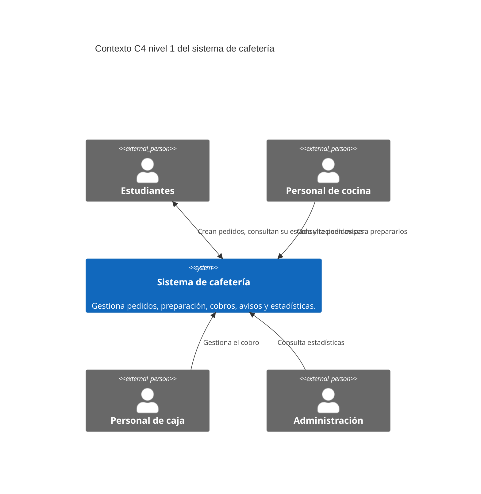

# Contexto del sistema de cafetería · C4 nivel 1

El alcance acordado por el grupo es el sistema de cafetería. La preparación,
la facturación y las notificaciones quedan dentro de ese límite. Los estudiantes
y el personal de cocina, caja y administración interactúan con el software desde
fuera del límite. [Diagrama de contexto del modelo C4](https://c4model.com/diagrams/system-context).

El diagrama representa el diseño acordado. En el proyecto actual, la API REST
permite crear y consultar pedidos. Las interfaces para los actores, los módulos
de cocina TCP y avisos WebSocket, el cobro y las estadísticas quedan pendientes.
