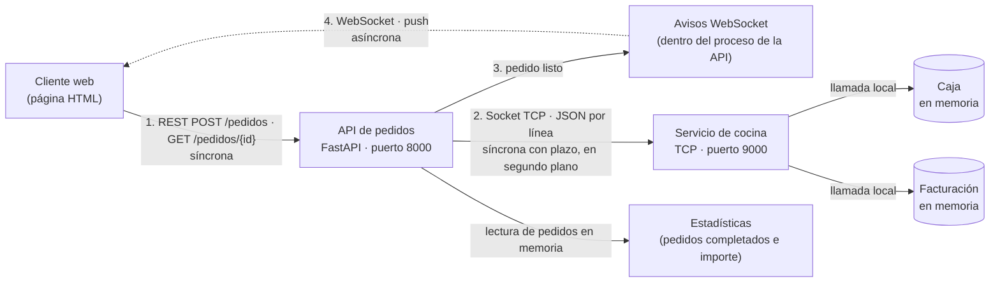
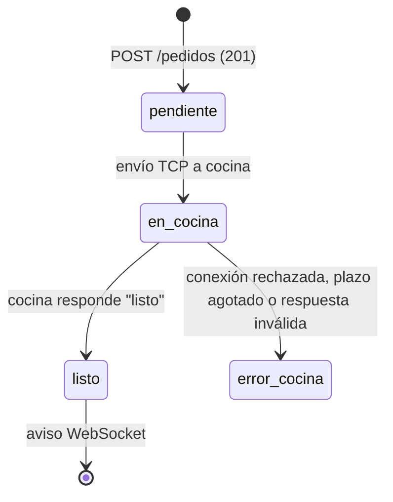

# Mapa de microservicios y conexiones

El sistema se divide en tres servicios que se ejecutan como procesos
independientes y un cliente web. Cada flecha indica un mecanismo de
comunicación y si quien inicia la comunicación espera la respuesta (síncrona)
o no (asíncrona).

## Recorrido de un pedido

1. El estudiante crea el pedido desde la página con `POST /pedidos` y una
   `Idempotency-Key`. La API lo guarda como `pendiente` y responde `201`
   sin esperar a cocina.
2. En segundo plano, la API cambia el pedido a `en_cocina` y lo envía por TCP
   al servicio de cocina. Cocina lo prepara, registra el cobro en caja, emite
   la factura y responde por la misma conexión.
3. La API guarda el pedido como `listo` con su número de factura. Si cocina no
   está disponible o no responde a tiempo, lo guarda como `error_cocina` con
   el motivo en el campo `error`.
4. Con el pedido ya guardado como `listo`, el servicio de avisos lo notifica
   por WebSocket al cliente conectado.

## Conexiones

| # | Origen → destino | Mecanismo | Tipo | Por qué | Ante una falla |
| --- | --- | --- | --- | --- | --- |
| 1 | Cliente web → API | REST sobre HTTP con JSON | Síncrona | El navegador necesita la confirmación inmediata del pedido y poder consultar su estado. | `Idempotency-Key` evita pedidos duplicados por reintento. Datos inválidos reciben `422`. |
| 2 | API → Cocina | Socket TCP con mensajes JSON delimitados por salto de línea | Síncrona (petición y respuesta en la misma conexión) | Es una comunicación interna entre dos servicios, con un mensaje corto y una respuesta concreta. Ver [ADR de sockets TCP](adr-sockets-tcp.md). | Plazo máximo configurable (`COCINA_TIEMPO_ESPERA`, 5 s por defecto). Si se agota o se rechaza la conexión, el pedido queda en `error_cocina` y la API sigue atendiendo. |
| 3 | API → Avisos | Llamada local (`al_listo`) | Síncrona, en el mismo proceso | El servicio de avisos mantiene las conexiones WebSocket abiertas en el proceso de la API. | Un fallo al avisar se registra en el log y no deshace el estado `listo`. |
| 4 | Avisos → Cliente web | WebSocket | **Asíncrona** | El servidor empuja el aviso cuando el pedido está listo; el cliente no tiene que consultar repetidamente. | Un cliente desconectado se descarta de la lista de suscriptores sin detener el procesamiento. |
| — | Cocina → Caja y Facturación | Llamada a funciones dentro del servicio de cocina | Síncrona, local | Simplificación del alcance: caja y facturación se registran de forma básica en memoria. | Ambos registros son idempotentes por ID: un pedido repetido no se cobra ni se factura dos veces. |
| — | Estadísticas | Lectura de los pedidos guardados en la API | Síncrona, local | Pedidos completados e importe vendido se calculan a partir de los pedidos `listo`. | — |

## Estados del pedido

## Responsables y estado de integración

| Componente | Responsable | Archivos |
| --- | --- | --- |
| API REST, idempotencia | Mateo | `app/main.py`, `app/pedidos.py`, `app/modelos.py` |
| Servicio de cocina TCP, caja y facturación | Veronica | `cocina/servidor.py`, `cocina/registros.py` |
| Cliente TCP usado por la API | Veronica | `app/cliente_cocina.py` |
| Página HTML, avisos WebSocket y estadísticas | Jonnathan | `app/pagina.py`, `app/avisos.py`, `app/estadisticas.py` |

La API publica el punto de integración `app.state.procesar_pedido(pedido_id)`.
El cliente TCP lo implementa con `crear_procesador(pedidos, bloqueo_pedidos,
al_listo=avisar_pedido_listo)`. El parámetro `al_listo` conecta cocina con los
avisos WebSocket.

## Limitaciones

- Caja y facturación viven dentro del proceso de cocina en lugar de ser
  servicios separados. Se eligió así para mantener el alcance del proyecto; el
  mapa las muestra como registros independientes porque tienen su propia
  responsabilidad y su propio bloqueo.
- Todos los datos están en memoria: reiniciar un servicio borra sus registros.
- Si cocina prepara un pedido pero la respuesta no llega a la API dentro del
  plazo, la API lo marca como `error_cocina` aunque caja ya lo haya cobrado.
  El reenvío del mismo ID no duplica el cobro, porque cocina devuelve el
  resultado anterior.
